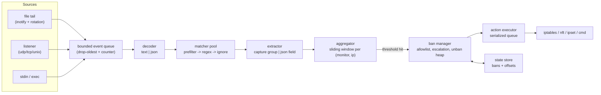

# Banhammer — System Design & Implementation Plan

A small, single-binary intrusion-prevention daemon in the spirit of `fail2ban`, without
the Python runtime, the `.conf`/`.local` inheritance maze, or the per-jail process fan-out.

---

## 1. Goals & Non-Goals

### Goals
* **Pluggable inputs:** tail files, listen on a socket (syslog/UDP/TCP), read stdin.
* **Text and JSON logs:** global regex on the raw line, or per-field regex on decoded JSON.
* **Offender extraction:** pull an IP/hostname out of the matched line (capture group) or out of a JSON field.
* **Threshold logic:** ban when an offender appears **X times in Y minutes**, unban after **Z minutes**.
* **Arbitrary ban actions:** `iptables` / `nftables` / `ipset` out of the box, any shell command otherwise.
* **Low footprint:** target **< 20 MB RSS** and near-zero idle CPU for a typical 5-monitor setup.
* **Minimal config:** a useful monitor should be 3 lines of YAML. Defaults do the rest.
* **Survives restarts:** active bans and file read offsets are persisted.

### Non-Goals (v1)
* No web UI, no database, no clustering/ban-sharing between hosts.
  *(Amended after v1: a read-only status **page** was added — one server-rendered HTML page of
  ban statistics, no JavaScript, no actions. The non-goal still stands for anything interactive:
  banning, unbanning and reloading remain CLI-only, over the Unix socket.)*
* No packet inspection — Banhammer only reads logs.
* No `fail2ban` filter/action file compatibility (we will ship a converter *hint* table, not a parser).
* No Windows support. Linux first, BSD best-effort.

---

## 2. Tech Stack

**Go**, single static binary, no runtime dependencies.

* **Regex:** stdlib `regexp` (RE2) — linear time, no catastrophic backtracking on hostile input.
* **Concurrency:** goroutines + channels map 1:1 onto the pipeline in §3.
* **Key types:** `netip.Addr` as the counter map key — 24 B, comparable, allocation-free.
* **Dependencies, deliberately few:** `fsnotify` (file watching), `cobra` (CLI), `gopkg.in/yaml.v3`.
  Everything else — JSON scanning, tailing, the scheduler, the firewall backends — is stdlib.
* **Toolchain:** Go 1.26.

---

## 3. Architecture

### 3.1 Pipeline



### 3.2 Ownership & concurrency model

| Stage | Goroutines | Notes |
|---|---|---|
| Source | 1 per source | Blocking reads. Emits `Event{Monitor, Raw []byte, Recv time.Time}`. |
| Queue | — | One bounded channel (default 8192). On full: **drop oldest**, bump `dropped_total`. A UDP flood must never OOM us. |
| Decode + match + extract | worker pool, `GOMAXPROCS` capped at 4 | The only CPU-bound stage. Stateless, so it parallelizes freely. |
| Aggregator | **exactly 1** | Owns all counters. Single-threaded ⇒ no mutexes, no lock contention, trivially correct. |
| Ban manager | **exactly 1** | Owns the ban table + unban min-heap + one `time.Timer` armed at the next expiry. |
| Action executor | 1 (serialized) | `iptables` is not concurrency-safe (`xtables` lock). Serial queue with retry/backoff. |
| Control server | 1 + per-conn | Unix socket for CLI (`status`, `ban`, `unban`, `reload`). |

The aggregator being single-threaded is the core simplification: all the tricky state
(counters, windows, eviction) lives in one goroutine's private memory.

### 3.3 Package layout

```
banhammer/
├── cmd/banhammer/main.go        # cobra CLI
├── internal/
│   ├── config/                  # YAML load, defaults, validation, <IP> macro expansion
│   ├── source/                  # Source interface: file, listen, stdin, exec
│   │   ├── tail.go              # inotify, rotation/truncation detect, offset tracking
│   │   └── listen.go            # udp/tcp/unix line + syslog framing
│   ├── decode/                  # text passthrough, json flattener (dotted paths)
│   ├── rule/                    # compiled matchers, prefilters, ignore rules, extraction
│   ├── window/                  # sliding-window counters, LRU cap
│   ├── ban/                     # ban table, unban heap, escalation, allowlist
│   ├── action/                  # backends: iptables, nft, ipset, cmd, dryrun
│   ├── store/                   # persistence (bans + offsets)
│   ├── control/                 # unix-socket control API
│   └── metrics/                 # counters, optional /metrics
├── config.example.yaml
├── PROJECT.md
└── README.md
```

---

## 4. Component Design

### 4.1 Sources

```go
type Event struct {
    Monitor string
    Raw     []byte    // borrowed from the reader's buffer until decode; copied only if retained
    Recv    time.Time
}

type Source interface {
    Run(ctx context.Context, out chan<- Event) error
    Offset() (Checkpoint, bool)   // for persistence; false if not seekable
}
```

**File tail (`file:`)**
* `fsnotify` watch on the file *and* its parent dir (to catch create-after-rotate).
* Rotation detection by `(dev, inode)` change; truncation by `size < offset` ⇒ seek to 0.
* `glob:` patterns (`/var/log/nginx/*.log`) with periodic rescan for new matches.
* On start: seek to **end** by default (`start_at: end|beginning|checkpoint`, default `checkpoint`
  falling back to `end`), so a restart doesn't replay and re-ban a week of history.
* Reads via `bufio.Scanner` with a configurable max line (default 64 KiB, oversized lines truncated + counted).

**Listener (`listen:`)**
* `udp://:5140`, `tcp://0.0.0.0:5140`, `unix:///run/banhammer.sock`.
* Framing: newline-delimited by default; optional RFC5425 octet-counting for TCP syslog.
* Optional `strip_syslog: true` to peel the `<PRI>timestamp host tag:` prefix before matching.
* Per-connection read deadline; hard cap on concurrent TCP conns (default 64).

**stdin / exec** — for `journalctl -f -u sshd | banhammer run` style usage and for testing.

### 4.2 Decoding

* `format: text` (default) — the raw line is the match subject.
* `format: json` — decoded into a flat map of dotted paths: `{"request":{"remote_ip":"1.2.3.4"}}`
  → `request.remote_ip`. Arrays index numerically (`headers.0`). Only the fields referenced by the
  monitor's rules and `ip_field` are materialized — we walk the JSON once and pluck, rather than
  building a full `map[string]any` (use `jsonparser`-style scanning to keep allocations near zero).
* Malformed JSON: counted as `decode_errors_total`, line dropped, rate-limited warning.

### 4.3 Rules & matching

A monitor's `match` is either:
* a **string** or **list of strings** → regex(es) against the whole line (OR semantics), or
* a **map** `field: regex` → all entries must match their respective JSON fields (AND semantics).

`ignore` has the same shape and vetoes a match (fail2ban's `ignoreregex`).

**The `<IP>` macro.** Writing an IPv4/IPv6 regex by hand is miserable, so `<IP>` (alias `<HOST>`)
expands to a vetted named capture group covering dotted-quad, bracketed/unbracketed IPv6, and —
for `<HOST>` only — DNS names (resolved, optionally, or ignored per `resolve: false`).
A pattern may alternatively use an explicit `(?P<ip>...)` group. Exactly one IP source is required
per monitor and config validation rejects ambiguity.

**Prefilter.** Regex is the hot path. Before running it, each compiled rule carries a required
literal substring (auto-derived from the pattern's literal prefix/factors via `regexp/syntax`, or
given explicitly as `contains:`). `bytes.Contains` rejects ~99% of lines at ~10× the speed of the
regex. Multi-pattern monitors additionally use an Aho-Corasick set over all prefilters.

### 4.4 Sliding window aggregation

```go
type counter struct {
    ticks []uint32   // seconds since daemon epoch, ring buffer, cap = threshold
    head  uint8
    n     uint8
    last  uint32     // for LRU eviction
}
// map key: netip.Addr (comparable, 24 B, no heap alloc)
counters map[netip.Addr]*counter   // per monitor
```

* Ring buffer capped at `threshold` entries — we never need the (X+1)-th timestamp. **Memory per
  tracked IP is O(threshold), not O(hits).** A flood of 1M hits from one IP costs the same as 5.
* Threshold check: `n == cap && now - ticks[oldest] <= window` ⇒ **ban**.
* Eviction: lazy on touch, plus a sweep every `window/4` over a bounded slice of the map
  (Go's randomized map iteration makes partial sweeps fair); plus a hard `max_tracked` cap
  (default 100k per monitor) with LRU drop so a spoofed-source UDP flood is bounded.
* Windows use a **monotonic** clock base; only persisted state uses wall time.

**Budget (measured, not estimated).** ~38 B Go map entry + 48 B slab entry (the `netip.Addr` is
stored twice: once as the map key, once in the entry for O(1) eviction) + 8 B of LRU links +
4 B×threshold of ticks ≈ **120 B per tracked IP**, independently measured at 100k IPs.
100k tracked IPs ≈ 12 MB worst case; a realistic host tracks a few hundred (≈ tens of KB).
Go runtime baseline is ~5 MB ⇒ the **< 20 MB RSS** goal holds, though a monitor deliberately
configured with `max_tracked: 100000` under a spoofed-source flood will use most of that headroom.

> [!NOTE]
> The first draft of this document estimated ~80 B/IP. That figure omitted the LRU links and the
> duplicated address key, which are what buy O(1) eviction. The important property — that memory
> is **flat in hit volume** — was verified: one million hits against a single IP produce a heap
> delta of zero.


### 4.5 Ban manager

* **Allowlist** checked first: list of IPs/CIDRs, plus `allow_local: true` (default) which
  auto-adds loopback + the host's own interface addresses + RFC1918 if configured.
* **Ban record:** `{ip, monitor, at, until, count, offense#}`. Dedupe: an already-banned IP that
  keeps matching only extends `until` if `on_repeat: extend` (default `ignore`).
* **Escalation** (default `bantime_factor: 2`, `bantime_max: 168h`): the *n*-th offense for an
  IP gets `min(bantime * factor^(n-1), max)`. Offense history kept for `find_history` (default 168h).
* **Unban scheduling:** a single min-heap keyed on `until` + one `time.Timer` re-armed at the head.
  Not one timer per ban. Wakeups are O(bans expiring), not O(bans).
* **Restart:** on start, load state; bans still in the future are re-applied to the firewall
  (idempotently) and re-queued; expired ones are unbanned/cleaned.

### 4.6 Actions

```go
type Backend interface {
    Start(ctx context.Context) error       // create chain/set (idempotent)
    Ban(ctx context.Context, b Ban) error
    Unban(ctx context.Context, b Ban) error
    Stop(ctx context.Context) error        // optional teardown on shutdown
}
```

Built-ins (selected by `action: <name>` or fully overridden by a command template):

| Backend | Mechanism |
|---|---|
| `iptables` (default) | Bootstraps chain `BANHAMMER` in `filter`, jumped to from `INPUT`. Ban = `-I BANHAMMER -s <ip> -j DROP`. IPv6 via `ip6tables` automatically. |
| `ipset` | One set (`banhammer4`/`banhammer6`, `hash:ip timeout`) + one iptables rule. **O(1) adds, scales to 100k+ bans**, and the kernel can own the timeout. Recommended for big deployments. |
| `nft` | `inet banhammer` table with a named set + timeout. Same scaling story, no iptables dependency. |
| `cmd` | Arbitrary `ban:` / `unban:` (and optional `start:`/`stop:`) shell templates. |
| `dryrun` | Logs what it would do. Default under `--dry-run`. |

* Template variables: `{ip}`, `{monitor}`, `{count}`, `{bantime}`, `{family}` (`inet`/`inet6`), `{matched}`.
* **No shell by default** — templates are tokenized and `exec`'d directly; `shell: true` opts into `sh -c`.
  `{ip}` is always a validated `netip.Addr` rendered by us, never raw log text, so injection is structurally impossible.
* Executor: serialized queue, per-command timeout (default 10 s), retry ×3 with backoff,
  failures logged + counted; a failing ban is retried but never blocks the pipeline.
* `flush_on_exit: false` by default (bans survive a daemon restart, matching the persisted state).
  When `true`, a clean shutdown (`SIGINT`/`SIGTERM`) tears down whatever `Start` built: the
  `BANHAMMER` chain and its jump rule for `iptables`, both sets plus their match rules for
  `ipset`, or the whole `inet banhammer` table for `nft`. Not applicable to `cmd`, which already
  gets an operator-supplied `stop:` template. A killed daemon (`SIGKILL`, a crash) never runs
  `Stop`, so this only fires on a graceful exit.

### 4.7 Persistence

`state_dir` (default `/var/lib/banhammer`), two files, both written atomically (tmp + rename):
* `bans.json` — active bans + offense history. Written on change, debounced to ≤1 write/s.
* `offsets.json` — per-source `{path, dev, inode, offset}`. Written every 5 s and on shutdown.

Plain JSON, not SQLite/bbolt: the working set is small, human-inspectable, and trivially recoverable.
(`bbolt` stays as the escape hatch if ban counts ever reach six figures.)

### 4.8 CLI & operations

```
banhammer run [-c config.yaml] [--dry-run]     # the daemon
banhammer check -c config.yaml                 # validate config, print effective/expanded settings
banhammer test -c config.yaml -m sshd -f sample.log   # what would match, what IPs, who'd be banned
banhammer status                               # live: monitors, tracked IPs, active bans, drops
banhammer ban 1.2.3.4 [--monitor x] [--time 1h]   # manual
banhammer unban 1.2.3.4 | --all
banhammer reload                               # re-read config (SIGHUP equivalent)
```

`banhammer test` is the feature that makes regex authoring bearable — it prints per-line
match/no-match, the extracted IP, and a simulated timeline of bans.

### 4.9 Observability

* Structured logs (`slog`), `--log-format text|json`, rate-limited for repeated errors.
* Counters: `lines_read`, `lines_dropped`, `matches`, `bans`, `unbans`, `action_errors`,
  `tracked_ips`, `decode_errors` — exposed via `banhammer status` and, if `metrics.listen` is set,
  a Prometheus endpoint.

---

## 5. Configuration

One YAML file. Three-line monitors must work; everything else is an override.
See [config.example.yaml](./config.example.yaml).

```yaml
# minimum viable config
monitors:
  sshd:
    file: /var/log/auth.log
    match: "Failed password .* from <IP>"
```

With defaults applied that means: 5 hits / 10 min ⇒ `iptables -j DROP` for 1 hour.

```yaml
# fuller example
defaults:
  threshold: 5          # X
  window: 10m           # Y
  bantime: 1h           # Z
  action: iptables

allowlist: [127.0.0.1/8, 10.0.0.0/8, 192.168.0.0/16]
state_dir: /var/lib/banhammer

monitors:
  sshd:
    file: /var/log/auth.log
    match:
      - "Failed password for .* from <IP>"
      - "Invalid user .* from <IP>"
    ignore: "from <IP> port .* ssh2: RSA"

  caddy:                          # JSON access log, per-field regexes
    file: /var/log/caddy/access.log
    format: json
    match:
      status: "^(401|403|404)$"
      request.uri: "\\.(env|git|php)$"
    ip_field: request.remote_ip
    threshold: 20
    window: 1m
    bantime: 24h

  remote-syslog:                  # everything from other hosts
    listen: udp://0.0.0.0:5140
    strip_syslog: true
    match: "authentication failure.*rhost=<IP>"
    action:
      ban:   "nft add element inet banhammer banned {{ {ip} }}"
      unban: "nft delete element inet banhammer banned {{ {ip} }}"
```

**Config principles**
1. Every knob has a default; `defaults:` overrides globally; a monitor key overrides per-monitor.
2. `file:`/`listen:`/`stdin:` are mutually exclusive shorthand — no nested `source:` block needed.
3. Durations are Go duration strings (`30s`, `10m`, `24h`).
4. `<IP>` beats hand-rolled address regex. `ip_field` beats regex entirely for JSON.
5. `banhammer check` fails loudly on unknown keys (no silent typos — a classic fail2ban footgun).

---

## 6. Failure Modes & Edge Cases

| Case | Handling |
|---|---|
| Log rotated / truncated | inode+size detection, reopen, resume at 0. Parent-dir watch handles create-after-rotate. |
| Log missing at startup | Not fatal; poll for creation, warn once. |
| Restart replay | Offsets persisted; `start_at: checkpoint` avoids re-banning on history. |
| Daemon down during ban | Bans re-applied idempotently at startup; already-expired ones cleaned up. |
| Clock jump / NTP step | Windows on monotonic clock; only ban expiry uses wall time (and is clamped to `bantime_max`). |
| UDP flood / spoofed sources | Bounded queue with drop-oldest + `max_tracked` LRU cap ⇒ memory is bounded by config, not by traffic. |
| Attacker-controlled log text | IPs are parsed to `netip.Addr` before use; commands are `exec`'d without a shell. Log-injection (fake newlines in a field) is mitigated by matching JSON fields, not raw lines, for JSON sources. |
| `iptables` locked / failing | Serialized executor, retry with backoff, counted + logged; pipeline never blocks. |
| Banning yourself | Allowlist includes local interface addresses by default; `banhammer unban --all` as the escape hatch; recommend a root ssh session open during first deploy. |
| IPv6 | Separate family handling throughout; `ip6tables`/`inet` set chosen by `{family}`. |
| Duplicate/overlapping monitors | Bans are keyed `(monitor, ip)` for accounting but deduped per-`ip` at the firewall layer. |

---

## 7. Implementation Plan

### Phase 0 — Walking skeleton (~1 day, target ≤ 800 LOC)
1. `go mod init banhammer`; cobra CLI with `run` + `check`.
2. `internal/config`: YAML load, defaults merge, strict unknown-key rejection, `<IP>` expansion.
3. `internal/source/tail.go`: plain polling tail first (inotify in P1), rotation via inode check.
4. `internal/rule`: single global regex + named capture extraction.
5. `internal/window`: ring-buffer sliding counter.
6. `internal/action`: `cmd` + `dryrun` backends only.
7. Wire the pipeline; **end-to-end goal: `banhammer run --dry-run` bans an IP from a fake auth.log.**

**Exit criteria:** text monitor, threshold ban, timed unban, all in memory, dry-run printing actions.

### Phase 1 — Real inputs & real bans (~2 days)
1. `fsnotify`-based tailing + glob sources + `start_at` semantics.
2. JSON decoding, per-field regexes, `ip_field`.
3. `listen://` sources (udp/tcp/unix) + syslog prefix stripping.
4. `iptables` backend with chain bootstrap, IPv6 support, serialized executor with retry.
5. Allowlist (CIDR + local interfaces).
6. Persistence (`bans.json`, `offsets.json`) and restart restore.
7. Unban min-heap + single timer.

**Exit criteria:** replaces a basic fail2ban `sshd` + nginx setup on a real host.

### Phase 2 — Operability (~2 days)
1. Unix-socket control API + `status` / `ban` / `unban` / `reload` CLI verbs.
2. `banhammer test` regex/timeline simulator.
3. `ipset` and `nft` backends.
4. Prefilter/Aho-Corasick optimization + a benchmark harness (`lines/sec/MB`).
5. Metrics, structured logging, SIGHUP reload.
6. systemd unit, `--user` friendly paths, README with a fail2ban migration table.

**Exit criteria:** deployable, observable, documented. **v1.0.**

### Phase 3 — Optional extras
Repeat-offender escalation · `journald` source · webhook/notification action ·
multi-monitor aggregate rules ("caught by 2+ monitors ⇒ longer ban") · ban list import/export ·
cross-host ban gossip.

### Testing strategy
* **Unit:** window math (table-driven, fake clock), config merge, `<IP>` expansion, JSON flattening, rotation detection.
* **Golden:** corpora of real `auth.log` / nginx / caddy lines with expected match+IP output.
* **Integration:** temp dir + fake log writer + `cmd` backend writing to a file ⇒ assert the exact ban/unban sequence. Fake clock so tests run instantly.
* **Fuzz:** `FuzzDecodeJSON`, `FuzzExtractIP` — no panics, no unbounded allocation on hostile input.
* **Bench:** `BenchmarkPipeline` on a 1M-line corpus; track lines/sec and `B/op` (allocations per line should be ~0 on the non-matching path).
* **Soak:** 24 h run with a synthetic flood; assert RSS stays flat (the real low-footprint proof).

---

## 8. Open Questions

1. **Default backend:** `iptables` (universal) or `ipset` (better, one more dependency)?
2. Is `journald` a required v1 source, or is `journalctl -f | banhammer run --stdin` good enough?
3. Single YAML file forever, or allow `conf.d/*.yaml` monitor drop-ins for package-managed monitors?
4. Does the host need IPv6 ban support on day one?
