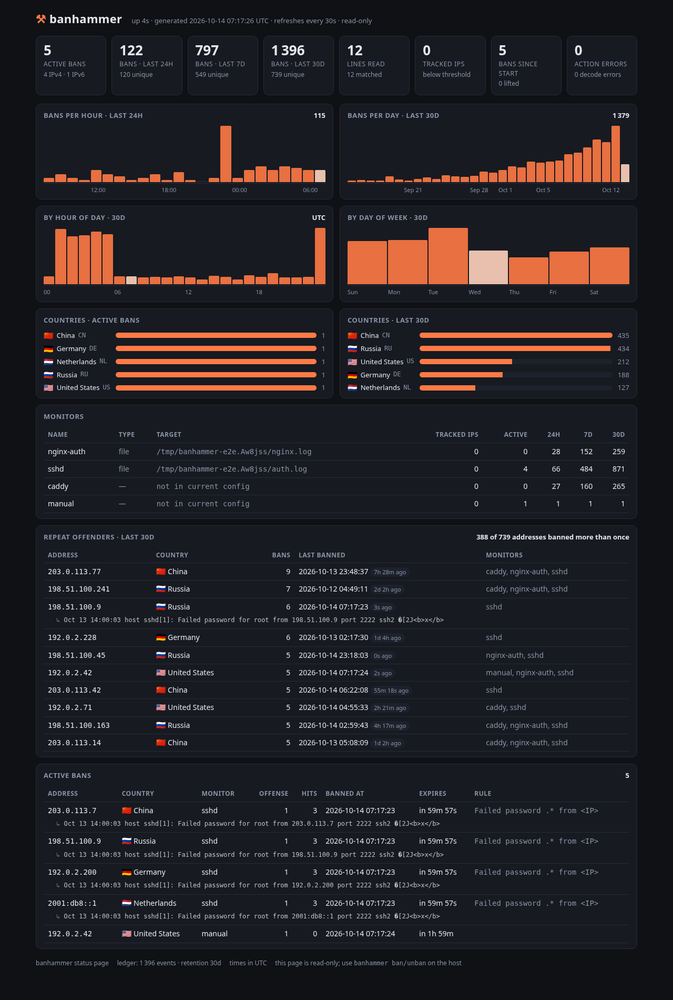
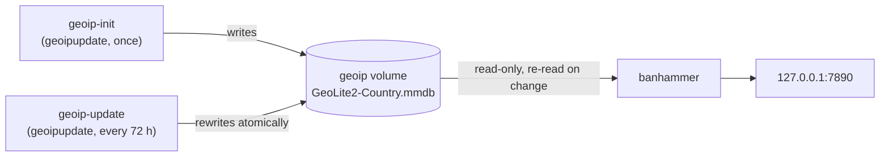

# Banhammer

A single-binary, low-footprint intrusion-prevention daemon — `fail2ban` without the Python
runtime or the `.conf`/`.local` inheritance maze.

Tail logs (text or JSON) from files or sockets, match offending lines, extract the offender's IP,
and ban it with `iptables`/`nft`/`ipset`/any command when it shows up **X times in Y minutes** —
then unban it **Z minutes** later.

```yaml
monitors:
  sshd:
    file: /var/log/auth.log
    match: "Failed password .* from <IP>"
```
> 5 hits in 10 minutes ⇒ `DROP` for 1 hour. That's the whole config.

**Status: v1 implementation complete.** Production-ready, fully tested with zero-allocation fast paths, sliding-window rate tracking, robust persistent state, and systemd sandboxing. See [PROJECT.md](./PROJECT.md) for product requirements and [docs/ARCHITECTURE.md](./docs/ARCHITECTURE.md) for package boundaries and invariants.

---

## Features

* **High Performance:** Over 6 million lines/sec throughput on text logs and over 1 million lines/sec on JSON logs. Zero heap allocations on non-matching log paths.
* **Low Memory Footprint:** Flat O(threshold) memory per tracked IP (~120 B/IP); strictly under 20 MB RSS in production.
* **Text and JSON Log Decoding:** Global regex with the `<IP>` macro on raw text lines, or nested dotted-field paths (`request.remote_ip`) with fast scanning on structured JSON.
* **Flexible Backends:** Built-in support for `iptables` (with automatic IPv4/IPv6 segregation), `nftables`, `ipset` (scales to 100k+ bans), and custom shell command templates (`cmd`).
* **Resilient Persistence:** Survives daemon restarts without replay loops; persists active bans and source read offsets atomically.
* **Built-in CLI Tooling:** Interactive rule tester (`test`), strict config validator (`check`), live status query (`status`), manual ban/unban commands, and dynamic configuration reloads.
* **Ban Statistics & Status Page:** A 30-day ban ledger behind `banhammer status` and an optional read-only, zero-JavaScript web dashboard — bans per hour/day, hour-of-day and weekday patterns, repeat offenders and (with a GeoIP database) country distribution.

---

## Installation & Quickstart

### 1. Build from Source

Banhammer requires Go 1.26+ and has zero C/C++ runtime dependencies.

```bash
# Clone and build
git clone https://github.com/roigabay/banhammer.git
cd banhammer
go build -o banhammer ./cmd/banhammer

# Verify binary
./banhammer --help
```

### 2. Validate Configuration

Verify your configuration syntax, inspect expanded `<IP>` macros, and view merged defaults:

```bash
./banhammer check -c config.example.yaml
```

### 3. Test Rules Interactively

Test your regexes and simulate sliding-window ban timelines against real or sample log files before deploying:

```bash
./banhammer test -c config.example.yaml -m sshd -f /var/log/auth.log
```

### 4. Run the Daemon

```bash
# Run in foreground with dry-run mode (logs actions without altering firewall)
./banhammer run -c config.example.yaml --dry-run

# Run in production
sudo ./banhammer run -c /etc/banhammer/config.yaml
```

---

## Configuration

Banhammer uses a single, declarative YAML configuration file. Default settings apply globally and can be overridden on a per-monitor basis. See [config.example.yaml](./config.example.yaml) for a complete reference.

```yaml
state_dir: /var/lib/banhammer
log_format: text
queue_size: 8192
allow_local: true
allowlist:
  - 127.0.0.1/8
  - ::1/128
  - 10.0.0.0/8
  - 192.168.0.0/16

defaults:
  threshold: 5          # hits before ban
  window: 10m           # sliding window
  bantime: 1h           # ban duration
  bantime_factor: 2     # exponential escalation multiplier
  bantime_max: 168h     # max ban duration
  find_history: 168h    # offense history retention
  max_tracked: 100000   # LRU cap for tracked IPs
  action: iptables      # iptables | nft | ipset | cmd
  # action:
  #   name: iptables
  #   flush_on_exit: false # true removes firewall state on a clean shutdown

monitors:
  sshd:
    file: /var/log/auth.log
    match:
      - "Failed password .* from <IP>"
      - "Invalid user .* from <IP>"
    ignore: "from <IP> port .* ssh2: RSA"

  caddy:
    file: /var/log/caddy/access.log
    format: json
    match:
      status: "^(401|403|404)$"
      request.uri: "\\.(env|git|ini|php)$"
    ip_field: request.remote_ip
    threshold: 20
    window: 1m
    bantime: 24h

  syslog-remote:
    listen: udp://0.0.0.0:5140
    strip_syslog: true
    match: "authentication failure.*rhost=<IP>"
    action: ipset

  docker-nginx:
    file: /var/log/nginx/docker-access.log
    match: '^<IP> .* "(GET|POST) [^"]*" 40[13] '
    action:
      name: iptables        # or ipset
      chain: DOCKER-USER    # attach jump/match rule to DOCKER-USER instead of INPUT
```

### Firewall Chain Attachment (`INPUT`, `DOCKER-USER`, `FORWARD`, etc.)

By default, Banhammer attaches its rules to the `INPUT` chain (`input` hook for `nft`). For services running inside Docker containers, Docker routes traffic through the `FORWARD` chain and evaluates the `DOCKER-USER` chain before its own rules. To block traffic destined for Docker containers, set `chain: DOCKER-USER` (with `iptables` or `ipset`) or `chain: forward` (with `nft`), either globally under `defaults.action` or per monitor under `monitors.<name>.action`:

```yaml
defaults:
  action:
    name: iptables
    chain: DOCKER-USER
```

For custom command actions (`cmd`), `{chain}` is available as a template variable alongside `{ip}`, `{monitor}`, `{bantime}`, `{count}`, `{family}`, and `{matched}`.

### Flush on Exit

By default, bans and the firewall state that enforces them survive a daemon restart: `Stop` is a no-op, matching the persisted state in `bans.json`. Set `flush_on_exit: true` on an action to instead tear everything down on a clean shutdown (`SIGINT`/`SIGTERM`):

```yaml
defaults:
  action:
    name: iptables
    flush_on_exit: true   # remove the BANHAMMER chain and its rules on shutdown
```

What gets removed depends on the backend:

| Backend | Removed on Stop |
|---|---|
| `iptables` / `ipset` | The jump/match-set rule in `chain` (default `INPUT`), then the `BANHAMMER` chain (or, for `ipset`, both `banhammer4`/`banhammer6` sets) |
| `nft` | The whole `inet banhammer` table (chain, sets and rules go with it) |
| `cmd` | Not applicable — use your own `stop:` template, which already runs unconditionally on shutdown |

`flush_on_exit` is per-action, so it follows the same inheritance rules as `chain` and `timeout`: a monitor that only sets `chain` or `timeout` keeps the default's `flush_on_exit`, while switching `name` or supplying command templates resets it to `false` unless set explicitly. A killed daemon (`SIGKILL`, a crash) never runs `Stop`, so bans are only removed by a graceful shutdown.

---

## CLI Command Guide

All CLI management commands communicate with the running daemon over its Unix domain control socket (`/run/banhammer/control.sock` when running as root, or `<state_dir>/control.sock`). You can override the socket path on any command with `-s, --socket`.

### `run` — Start Daemon
Starts the intrusion prevention daemon, ingestion sources, matching workers, aggregator, and action executor.

```bash
banhammer run -c /etc/banhammer/config.yaml [flags]
```
* `-c, --config`: Path to configuration file (default: `/etc/banhammer/config.yaml` or `./config.yaml`).
* `-s, --socket`: Control socket path override.
* `--dry-run`: Evaluate logs and report bans without executing firewall changes.
* `--state-dir`: Override persistent state directory.
* `--log-format`: Log output format (`text` or `json`).
* `--log-level`: Logging verbosity (`debug`, `info`, `warn`, `error`).

### `check` — Validate Configuration
Strictly validates YAML syntax, monitors, source definitions, regex compilation, and macro expansion. Fails loudly on unknown keys.

```bash
banhammer check -c /etc/banhammer/config.yaml
```

### `test` — Rule & Timeline Simulator
The regex authoring tool: simulates log parsing line-by-line against sample files, displaying per-line verdicts (`MATCH`, `NO_MATCH`, `IGNORED`, `NO_IP`), extracted IPs, allowlist filtering, and simulated timestamps for triggered bans and unbans (expiries).

```bash
banhammer test -c /etc/banhammer/config.yaml -m sshd -f /var/log/auth.log --rate 5s
```
* `-m, --monitor`: Name of the monitor to test.
* `-f, --file`: Path to sample log file (or `-` for stdin).
* `--rate`: Simulated time step advanced per log line (default `1s`).

### `status` — Live Daemon Telemetry
Queries the active daemon for uptime, pipeline metrics (lines read, dropped, matched), monitor status, tracked IPs, the list of active bans, and the ban history: bans and unique addresses over the last 1h / 24h / 7d / 30d, a per-monitor breakdown, the top repeat offenders, top countries (when a GeoIP database is configured, see [Status Page](#status-page--ban-statistics)) and a sparkline of the last 24 hours and 30 days.

```bash
banhammer status
banhammer status --json
```

```
History (last 30d, 412 events):
  WINDOW  BANS  UNIQUE IPS
  1h      3     3
  24h     57    49
  7d      188   151
  30d     412   302
  Repeat offenders: 61 of 302 addresses banned more than once

  Top offenders:
    IP              COUNTRY        BANS  LAST BANNED          MONITORS
    203.0.113.77    Germany (DE)   9     2026-10-13 03:12:40  sshd
    ...

  Last 24h: ▁▂▁ ▁▁▃█▅▂▁  ▁▁▂▁ ▁▁▂▃▂▁▁  (57 bans, peak 11/h)
```

### `ban` — Manually Ban an IP
Manually adds an IP address to the firewall ban list for a designated period (or the monitor's configured `bantime` if `--time` is omitted).

```bash
banhammer ban 198.51.100.25
banhammer ban 203.0.113.50 --time 24h --monitor sshd
```

### `unban` — Lift Bans
Removes an active firewall ban for an IP, or flushes all active bans.

```bash
banhammer unban 198.51.100.25
banhammer unban --all
```

### `reload` — Dynamic Configuration Reload
Instructs the running daemon to re-read its configuration file and recompile rule sets without dropping active state or restarting.

```bash
banhammer reload
```

---

## Observability & Prometheus Metrics

When `metrics.listen` is configured (e.g. `127.0.0.1:9090`), Banhammer exposes an HTTP server with two endpoints:

* `GET /metrics`: Prometheus text exposition format (0.0.4).
* `GET /healthz`: Liveness probe (`200 OK`).

### Exported Metrics

All counters and gauges use the `banhammer_` namespace prefix:

| Metric Name | Type | Labels | Description |
|---|---|---|---|
| `banhammer_lines_read_total` | Counter | `monitor` | Total number of log lines read from sources. |
| `banhammer_lines_dropped_total` | Counter | `monitor` | Total number of log lines dropped due to queue saturation or buffer limits. |
| `banhammer_matches_total` | Counter | `monitor` | Total number of log lines matching monitor attack patterns. |
| `banhammer_bans_total` | Counter | `monitor` | Total number of bans issued. |
| `banhammer_unbans_total` | Counter | `monitor` | Total number of bans lifted, by expiry or by hand. |
| `banhammer_action_errors_total` | Counter | `backend` | Total number of firewall action execution failures. |
| `banhammer_decode_errors_total` | Counter | `monitor` | Total number of log decoding or JSON parsing failures. |
| `banhammer_tracked_ips` | Gauge | `monitor` | Current number of unique offending IP addresses tracked in memory. |
| `banhammer_active_bans` | Gauge | `monitor` | Current number of active firewall IP bans in effect. |
| `banhammer_uptime_seconds` | Gauge | — | Total daemon uptime in seconds. |

### Prometheus Scrape Configuration

```yaml
scrape_configs:
  - job_name: "banhammer"
    scrape_interval: 15s
    static_configs:
      - targets: ["127.0.0.1:9090"]
```

---

## Status Page & Ban Statistics

Banhammer keeps a bounded **ban ledger** — every ban it issues, for the last 30 days by default — and can serve a small read-only dashboard from it:

```yaml
web:
  enabled: true                  # off by default
  listen: 127.0.0.1:7890         # default
  geoip: /usr/share/GeoIP/GeoLite2-Country.mmdb   # optional
  retention: 720h                # default: 30 days
  log_lines: true                # default: keep the line that triggered each ban
```

Then open <http://127.0.0.1:7890/>.



### What it shows

| Section | Source |
|---|---|
| Active bans (IPv4/IPv6 split), bans + unique addresses over the last 24h / 7d / 30d, pipeline counters | live ban table + ledger |
| Bans per hour (last 24h) and per day (last 30d) | ledger |
| Hour-of-day and day-of-week distribution, in the daemon's local time zone | ledger |
| Countries of the active bans and of the last 30 days | ledger + GeoIP database |
| Per-monitor table: tracked IPs, active, 24h / 7d / 30d | live + ledger |
| Repeat offenders: most-banned addresses, last ban, which monitors caught them, and the latest log line that got them banned | ledger |
| Active bans with country, offense number, hit count, expiry, the rule that fired and **the log line that triggered the ban** | live ban table + ledger |

The same data is available as JSON at `/status.json` (identical to `banhammer status --json`), and `/healthz` answers `200 ok` for liveness probes.

### Security posture

The page is designed to be safe to leave running on a security daemon:

* **Read-only by construction.** There are no forms, no actions and no JavaScript — the HTML is rendered on the server, charts are plain CSS, and the page refreshes itself with a `<meta refresh>`. It cannot ban, unban or reload anything; use the CLI on the host for that.
* **Only `GET` and `HEAD`** are answered; every other method gets `405`. Unknown paths get `404`.
* A strict `Content-Security-Policy` (`default-src 'none'`) plus `X-Frame-Options: DENY`, `nosniff`, `Referrer-Policy: no-referrer` and `Cache-Control: no-store` on every response. All dynamic values pass through `html/template`.
* Rendered output is cached for one second, so a request flood costs one status snapshot per second, not one per request.
* **Loopback by default.** The page lists every banned address and every watched log path, which is useful reconnaissance; it binds to `127.0.0.1` unless you say otherwise. To reach it from elsewhere, set `listen: 0.0.0.0:7890` and put it behind a reverse proxy that handles TLS and authentication, or tunnel to it (`ssh -L 7890:127.0.0.1:7890 host`).

### Geography (optional)

Set `web.geoip` to a country database and the page (and `banhammer status`) gain country columns and charts. Two formats are read, chosen by file extension, with no external dependency:

* **MaxMind DB** (`.mmdb`): [GeoLite2-Country](https://dev.maxmind.com/geoip/geolite2-free-geolocation-data) (free with an account; `geoipupdate` keeps it fresh at `/usr/share/GeoIP/GeoLite2-Country.mmdb`), GeoIP2-Country, or the [DB-IP country mmdb](https://db-ip.com/db/download/ip-to-country-lite).
* **CSV** (`start_ip,end_ip,country_code`, optionally `.gz`): [DB-IP Country Lite](https://db-ip.com/db/download/ip-to-country-lite) or the daily-updated files in [sapics/ip-location-db](https://github.com/sapics/ip-location-db) (e.g. `dbip-country/dbip-country-ipv4.csv` + `-ipv6.csv` concatenated, or `geolite2-country`).

The database is only ever consulted for display. It is never involved in a ban decision, and a missing or corrupt file fails startup with a clear error rather than silently showing nothing.

**Keeping it fresh is not banhammer's job, noticing is.** Run `geoipupdate` (or the Docker sidecar below) on whatever schedule you like; the daemon stats the file once a minute and reopens it when it has changed, so a refresh is live within a minute with no reload and no restart. A replacement that does not parse is logged once and the previous database is kept. `banhammer reload` also reopens it, and applies a changed `retention`; changing `listen` needs a restart.

### Offending log lines

For every ban the pipeline issues, the log line that crossed the threshold is kept and shown under the ban (and under each repeat offender, and as `↳ …` in `banhammer status`). Manual bans have none. A few things are worth knowing:

* **It is attacker-written text, treated as such.** Lines are reduced to printable UTF-8 (control characters, including terminal escapes, become `�`) and cut at 512 bytes *before* they are stored, so they are safe to print in a terminal; the page additionally HTML-escapes them. They never enter `model.Ban`, so they can never reach an action's command line.
* **It is cheap.** Only matching lines are copied, into a per-worker 64 KiB arena, so the cost is one allocation per 64 KiB of matched text; the non-matching path stays allocation-free. Lines are capped at 4 MiB in total: beyond that the oldest events keep their counts and drop their text.
* **It is optional.** Logs can carry usernames, URLs or e-mail addresses. Set `web.log_lines: false` (reloadable) and nothing is captured or written to `history.json`.

### The ledger

Ban events are kept in memory (64 bytes each plus the log line, capped at 100 000 events regardless of `retention`) and persisted to `<state_dir>/history.json` once a minute when anything changed, and at shutdown, so a restart does not blank the charts. Like the other state files it is replaceable: a corrupt file is set aside as `history.json.corrupt` and the daemon starts with an empty ledger. Only *new* bans are recorded — a ban re-applied at startup, or extended while live, does not count twice.

The page shows at most 500 active bans (soonest to expire first) and says how many more there are; `/status.json` and `banhammer status` always list all of them.

---

## Fail2ban Migration Guide

Banhammer replaces Fail2ban's multi-file configuration maze (`jail.conf`, `jail.local`, `filter.d/*.conf`, `action.d/*.conf`) with a clean, single-file YAML format, while providing equivalent or superior functionality.

### Directive Comparison

| Fail2ban Directive / Concept | Banhammer Equivalent | Notes |
|---|---|---|
| `[jail-name]` | `monitors.<name>` | Each monitor represents an independent log ingestion and rule set. |
| `logpath = /var/log/auth.log` | `file: /var/log/auth.log` | Supports glob expressions (e.g. `/var/log/nginx/*access.log`). |
| `backend = systemd` / socket | `listen: udp://...` or `stdin: true` | Listen directly on UDP/TCP/Unix sockets, or pipe via `journalctl -f \| banhammer run`. |
| `maxretry = 5` | `threshold: 5` | Number of offenses within the window before banning. |
| `findtime = 10m` | `window: 10m` | Sliding-window evaluation duration (e.g., `30s`, `10m`, `24h`). |
| `bantime = 1h` | `bantime: 1h` | Base ban duration. |
| `bantime.increment = true` | `bantime_factor: 2` | Exponential backoff multiplier on repeat offenses. |
| `bantime.maxtime = 1w` | `bantime_max: 168h` | Maximum escalated ban duration ceiling. |
| `ignoreip = 127.0.0.1/8` | `allowlist: [...]` | List of CIDR blocks or IPs that are never banned. |
| Automatic loopback whitelist | `allow_local: true` | Automatically whitelists loopback and local host interface IPs. |
| `failregex = ...` | `match: "..."` or `match: [...]` | String or list of regex patterns (OR semantics). Uses Go RE2 (linear time). |
| `ignoreregex = ...` | `ignore: "..."` or `ignore: [...]` | Patterns that veto a match when triggered. |
| `<HOST>` / `<IP>` | `<IP>` or `<HOST>` | Macro expanding to robust IPv4 and IPv6 capture regex. |
| JSON log filtering | `format: json` + `match: {field: regex}` | Native JSON decoding with dotted field paths (AND semantics). No python regex hacks. |
| `banaction = iptables-multiport` | `action: iptables` | Built-in `iptables` backend handles chains and IPv4/IPv6 automatically. |
| `chain = INPUT` / `DOCKER-USER` | `action: { chain: DOCKER-USER }` | Configurable chain attachment (`INPUT` by default, `DOCKER-USER` for Docker, `FORWARD`, etc.). |
| `banaction = nftables-multiport` | `action: nft` | Native `nftables` tables and sets (`chain: input`, `forward`, etc.). |
| `banaction = ipset` | `action: ipset` | High-performance hash sets with O(1) matching; handles 100k+ bans. |
| Custom action scripts | `action: cmd` | Command templates with `{ip}`, `{monitor}`, `{bantime}`, `{count}`, `{chain}`. |

### Migration Example: SSH Jail

#### Fail2ban (`/etc/fail2ban/jail.local` & `/etc/fail2ban/filter.d/sshd.conf`)
```ini
[sshd]
enabled = true
port = ssh
logpath = /var/log/auth.log
maxretry = 5
findtime = 10m
bantime = 1h
ignoreip = 127.0.0.1/8 10.0.0.0/8
failregex = ^%(__prefix_line)sFailed \S+ for .* from <HOST>(?: port \d+)?(?: ssh\d*)?$
            ^%(__prefix_line)s[iI]nvalid user .* from <HOST>(?: port \d+)?(?: ssh\d*)?$
```

#### Banhammer (`/etc/banhammer/config.yaml`)
```yaml
allowlist: [127.0.0.1/8, 10.0.0.0/8]

monitors:
  sshd:
    file: /var/log/auth.log
    threshold: 5
    window: 10m
    bantime: 1h
    match:
      - "Failed .* for .* from <IP>"
      - "Invalid user .* from <IP>"
```

---

## Docker

The [`Dockerfile`](./Dockerfile) builds a static binary into an Alpine image with `iptables`, `nftables` and `ipset` installed, running unprivileged by default. [`docker-compose.yml`](./docker-compose.yml) is a complete deployment including an automatically refreshed GeoLite2 country database:

```bash
cp .env.example .env            # MaxMind account ID + license key (free account)
cp config.example.yaml config.yaml
docker compose up -d
open http://127.0.0.1:7890/
```



* **The license key reaches only the `geoipupdate` containers**, via `.env` (git- and docker-ignored). Banhammer has no download code and no key: fetching data is a job for MaxMind's own tool; banhammer only reads the file and reopens it when it changes.
* `geoip-init` runs once so the file exists before banhammer starts; `geoip-update` keeps it current. `GEOIPUPDATE_FREQUENCY` is in hours — GeoLite2 is published twice a week, so 72 is plenty and stays well inside MaxMind's daily limit.
* Set `web.geoip: /usr/share/GeoIP/GeoLite2-Country.mmdb` in your `config.yaml` (the path inside the container).
* Real firewall bans need the host network namespace and `CAP_NET_ADMIN`; the commented lines in the compose file show the flags. `action: dryrun`, the metrics endpoint and the status page work without them.
* Only `9777` (metrics) and `7890` (status page) are exposed, and the compose file binds the page to the host's loopback.

---

## Systemd Service Deployment

A hardened systemd unit file is included in [`banhammer.service`](./banhammer.service) featuring strict sandboxing, unprivileged execution options, read-only system protection, and capabilities management.

### Deployment Steps

1. **Build and install the binary:**
   ```bash
   go build -ldflags="-s -w" -o /usr/bin/banhammer ./cmd/banhammer
   chmod 755 /usr/bin/banhammer
   ```

2. **Install configuration:**
   ```bash
   mkdir -p /etc/banhammer
   cp config.example.yaml /etc/banhammer/config.yaml
   chmod 644 /etc/banhammer/config.yaml
   ```

3. **Install and activate the systemd unit:**
   ```bash
   cp banhammer.service /etc/systemd/system/
   systemctl daemon-reload
   systemctl enable --now banhammer
   ```

4. **Verify operation:**
   ```bash
   systemctl status banhammer
   banhammer status
   ```

5. **Reload configuration dynamically:**
   ```bash
   # Both systemctl reload and banhammer reload send SIGHUP / IPC reload
   systemctl reload banhammer
   # OR
   banhammer reload
   ```

---

## Docker

The published image runs as **root** by default. Banhammer's firewall backends
(`iptables`/`ip6tables`/`nftables`/`ipset`) need at least `CAP_NET_ADMIN` and
`CAP_NET_RAW` to mutate host firewall state, and root avoids fighting
capability plumbing across the different backends and their helper binaries.

If your setup allows it and you only need `action: dryrun` or the metrics
endpoint (no real firewall mutation), you can drop privileges yourself:

```bash
docker run \
  --user 1000:1000 \
  --cap-add=NET_ADMIN --cap-add=NET_RAW \
  -v $(pwd)/config.yaml:/etc/banhammer/config.yaml \
  banhammer
```

Note that capabilities alone may not be sufficient for every backend/kernel
combination (e.g. some `iptables-legacy` or `nftables` setups still expect an
actual root UID) — fall back to running as root if you hit permission errors.

---

## Performance & Verification

Banhammer includes comprehensive benchmarks measuring throughput across synthetic 1M-line corpora:

```bash
# Run all unit and integration tests
go test ./...

# Run pipeline benchmark suite
go test -bench=BenchmarkPipeline -benchtime=1s ./test
```

### Typical Benchmark Results
* **`auth.log` throughput:** ~6,000,000 lines/sec (0 B/op, 0 allocs/op)
* **`auth.log` non-matching reject path:** ~26,000,000 lines/sec (0 B/op, 0 allocs/op)
* **JSON access log throughput:** ~1,000,000 lines/sec
* **Idle memory usage:** < 10 MB RSS

---

## License

Apache 2.0. See LICENSE for details.
