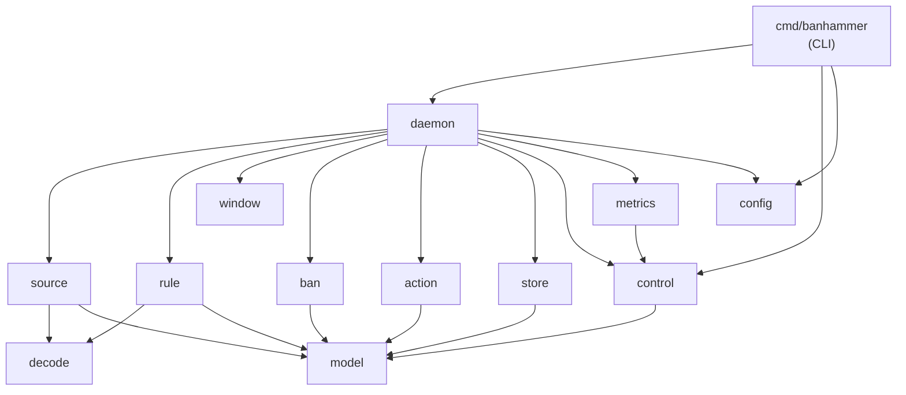
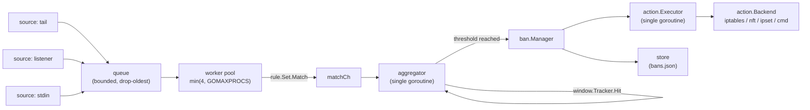

# Banhammer — Architecture

This document describes how the packages fit together and which invariants hold across package
boundaries. It deliberately contains **no function signatures**: those live in the source, where
they cannot go stale. Use `go doc ./internal/<pkg>` for the API of any package, and read
[PROJECT.md](../PROJECT.md) for the product requirements this design serves.

What you will find here instead is the information a signature cannot carry: who owns which piece
of mutable state, which goroutine runs what, and which rules you will break if you move code
between packages.

## Package graph

`internal/model` is the only package every layer may import, and it imports nothing from this
module. That is what keeps the graph acyclic: `ban` never learns what a firewall is, `action`
never learns what a log line is, and both agree on `model.Ban`.

> [!NOTE]
> `metrics` importing `control` is the one wart in the graph. `metrics.Registry` builds a
> `control.Stats` so the daemon can answer `banhammer status` from one place. It means `control`
> can never import `metrics`; if that ever becomes necessary, move `Stats` down into `model`.

## Runtime data flow

Each stage exists to make the next one single-threaded or lock-free:

| Stage | Goroutines | Why it is shaped that way |
|---|---|---|
| Sources | one per monitor | Each owns its file handles and sockets; no shared state. |
| Queue | — | Bounded and drop-oldest. PROJECT.md §6 requires that a log flood cost accuracy, never memory. Drops are counted, not silent. |
| Workers | `min(4, GOMAXPROCS)` | Regex matching is the only CPU-bound stage. Workers touch no shared mutable state; `rule.Set` is read-only after compile and internally pooled. |
| Aggregator | exactly one | It owns every `*window.Tracker`. The trackers are therefore not goroutine-safe *by design* — that is what makes them cheap. |
| Ban manager | caller's goroutine + one expiry goroutine | One mutex over the ban map, the unban heap, the history and the policies. |
| Executor | exactly one | `iptables` is not concurrency-safe. Serializing here means no backend has to be. |

## Cross-package invariants

These are the rules that are easy to break from the outside.

**`ban.Enforcer` is called with the manager's mutex held.** An enforcer must be non-blocking and
must never call back into the manager. `action.Executor` satisfies this because its `Ban`/`Unban`
only enqueue. A blocking enforcer deadlocks the whole ban path.

**`ban.Persister` is called *without* the lock**, and writes are ordered by a sequence number so a
slow write can never resurrect older state. Hence `store.SaveBans` may take as long as it likes.

**`window.Tracker` is single-owner.** Only the aggregator may touch one. The reload path
(`applyTrackerConfig`) runs on the aggregator goroutine for this reason, and keeps trackers whose
shape is unchanged: rebuilding one discards every in-flight counter, which would silently reset an
attacker's progress towards the threshold on every SIGHUP.

**`model.Event.Raw` is only valid until the consumer returns.** Sources reuse their read buffers.
Anything that must outlive the call has to be copied; the pipeline is built so that nothing does.

**`model.Ban.Matched` is operator data, not attacker data.** It carries the rule *pattern* that
fired, never the log line. Actions substitute it into `{matched}`, and `bans.json` persists it.

**Prefilter soundness.** `rule` may skip a regex only when a required literal is absent from the
line. If a prefilter ever rejects a line the regex would have matched, that is a missed ban, so
the property is fuzz-tested rather than merely unit-tested.

**State files are replaceable.** A corrupt, truncated or oversized `bans.json`/`offsets.json` is
renamed aside as `.corrupt` and the daemon starts fresh. Losing bans is an inconvenience; refusing
to boot is an outage.

## Shutdown order

`Daemon.Run` tears down in a fixed order so that no stage is ever fed by a stage that has already
stopped, and nothing is lost:

1. Cancel sources, wait for them.
2. Close the event queue, drain the workers.
3. Close the match channel, drain the aggregator.
4. Persist offsets, flush the store.
5. Stop the control and metrics servers.
6. Stop the ban manager.
7. Stop the executor — it drains its queue with a detached context, so bans enqueued at the last
   moment still reach the firewall.
8. Tear down the action backend.
9. Close the store and release the lockfile.

A `Daemon` is single-use: step 2 closes channels, so `Run` refuses a second call.

## Testing conventions

* Table-driven tests everywhere.
* **No test sleeps for real time.** Every package that deals with time takes an injectable clock,
  and `ban` additionally takes an injectable timer constructor.
* No test touches a real firewall: `action` tests inject a `Runner` that records exact argv.
* Allocation assertions live behind a `!race` build tag (`race_test.go` / `norace_test.go`),
  because race instrumentation allocates on its own account.
* The non-matching path through `rule.Set.Match` must stay allocation-free; `test/` asserts it.

## House style

* Doc comments explain *why*, not *what*. Public identifiers always have one.
* Errors are wrapped with `%w` plus context.
* Logging is `log/slog` only, and loggers are injected — libraries never reach for the default.
* Repeated errors are rate-limited. A permanently unreadable file must not produce one log line
  per poll.
* Dependencies: `fsnotify`, `cobra`, `yaml.v3`, `golang.org/x/sys`. Adding one is a design
  decision, not a convenience.
